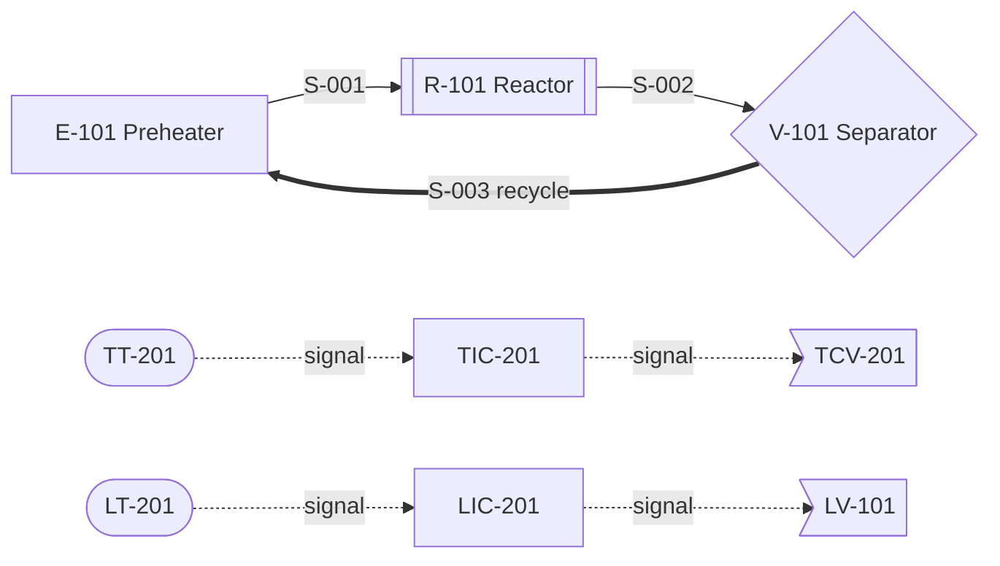

# EngineeringStudio — Master Requirements
# Version 0.7 · April 2026
# Anchor document for all development sessions
# Supersedes: engineering-studio-requirements-v0.6.md

---

## 1. Purpose and Context

EngineeringStudio is a browser-based AI-powered engineering configuration tool that:

1. Converts engineering source documents (P&IDs, equipment lists, datasheets, YMPL files) into structured plant configuration
2. Provides a graphical process topology editor for direct authoring and surgical patching
3. Exports to multiple target formats via output adapters — VIDS YAML for enVIEW, YMPL for enableSim, extensible for others

EngineeringStudio does NOT run at operator runtime. It is used during project commissioning, configuration changes, and simulation development.

---

## 2. Architecture Principle

**Flexible input → AI processing → Flexible output**

EngineeringStudio is the intelligent middle layer. It does not enforce a single schema on either input or output. The AI understands both ends.

```
┌─────────────────────────────────────────────────────────────┐
│                    EngineeringStudio                        │
│                                                             │
│  ┌─────────────────┐      ┌──────────────────────────────┐  │
│  │   Input Layer   │      │     Graphical Editor         │  │
│  │                 │      │     (React Flow canvas)      │  │
│  │  P&ID PDF       │      │                              │  │
│  │  Equipment CSV  │      │  Draw / Import / Patch       │  │
│  │  YMPL file      │      │  Engineer never edits        │  │
│  │  Datasheet PDF  │      │  output format directly      │  │
│  │  Plain text     │      │                              │  │
│  └────────┬────────┘      └──────────────┬───────────────┘  │
│           │                              │                  │
│           ▼                              ▼                  │
│           ┌──────────────────────────────┐                  │
│           │    Internal Project Model    │                  │
│           │    (normalized, in-memory)   │                  │
│           └──────────────┬───────────────┘                  │
│                          │                                  │
│           ┌──────────────┼──────────────┐                  │
│           ▼              ▼              ▼                  │
│      VIDS Adapter   YMPL Adapter   Future adapters         │
│           │              │              │                  │
└───────────┼──────────────┼──────────────┼───────────────────┘
            ▼              ▼              ▼
         enVIEW        enableSim       Others
       vplant import  enable build   (Ignition, DeltaV)
```

---

## 3. Internal Project Model

The internal model is normalized, in-memory, and adapter-agnostic.
It is NOT a file format — it is the working representation inside EngineeringStudio.

### Core Minimum (every output adapter must receive this)

```
Equipment:
  tag          — ISA tag (E-101, R-101)
  type         — ISA equipment class (heat_exchanger, reactor, vessel, pump, valve...)
  description  — free text
  area         — plant area or unit

Instrument:
  tag          — ISA tag (FT-101, TIC-201)
  type         — instrument class (flow_transmitter, pid_controller, control_valve...)
  equipment_ref — parent equipment tag
  range_lo     — engineering range low
  range_hi     — engineering range high
  units        — engineering units
  alarm_hihi   — high high limit (engineering units)
  alarm_hi     — high limit
  alarm_lo     — low limit
  alarm_lolo   — low low limit
  fail_position — open | closed | last

Connection:
  id           — stream label (S-001)
  from_tag     — source equipment tag
  from_port    — top | bottom | left | right | center
  to_tag       — destination equipment tag
  to_port      — top | bottom | left | right | center
  type         — process | instrument_signal | electrical | pneumatic | hydraulic
  fluid        — liquid | gas | steam | mixed | undefined
  line_size    — pipe size (4in, DN100, etc.)
  flow         — design flow rate
```

Everything beyond the core minimum is adapter-specific.

---

## 4. Output Adapters

### 4A — VIDS Adapter (enVIEW)

Converts internal model → VPlant YAML (VIDS v1.0) for `vplant import`.

**Field mapping:**

```
Equipment   → plant_screens entry (type, description, area)
Instrument  → tag_configs (dcs_tag, range_lo/hi, units)
             + alarm_configs (alarm_hihi/hi/lo/lolo)
Connection  → EquipmentConnectionStore entry
              (fromEquipmentId, toEquipmentId, fromPort, toPort, lineType)
              routing: auto-assigned on import, engineer adjusts in enVIEW canvas
```

**Canvas layout:** Not exported. enVIEW auto-positions equipment on import.
Engineer adjusts positions in enVIEW canvas. This is a one-time task per project.

**VIDS output format:**

```yaml
metadata:
  plant_name: "DHTU Unit 400"
  drawing_number: "P&ID-400-001"
  revision: 3
  date: 2026-04-15
  process_type: refinery
  changelog:
    - rev: 3, date: 2026-04-15, by: Engineer, change: "Added alarm setpoints"

instruments:
  FT-101:
    type: flow_transmitter
    description: "Feed flow to reactor"
    dcs_tag: "ns=2;i=1001"
    range_lo: 0.0
    range_hi: 500.0
    units: kg/h
    alarm_hihi: 490.0        # [VERIFY — safety critical]
    alarm_hi: 450.0
    alarm_lo: 50.0
    alarm_lolo: 10.0
    fail_position: closed
    area: FEED
    equipment_ref: E-101

equipment:
  E-201:
    type: heat_exchanger
    description: "Feed/effluent exchanger"
    tag: E-201
    area: REACTION

connections:
  - id: S-001
    from_tag: P-101
    from_port: right
    to_tag: E-201
    to_port: left
    type: process
    fluid: liquid
    line_size: 4in

screens:
  - name: "Feed Section"
    area: FEED
    equipment: [P-101, E-201]
    page: 1
```

**Validation:** Output must pass `vplant validate` before export is allowed.

**Import command shown on export:**
```
vplant import dhtu_feed.yaml --project "DHTU Unit 400"
```

**Alarm representation — VIDS uses engineering units:**

VIDS carries operator-facing alarm limits in engineering units:
```
alarm_hi:   280.0 degC   ← what operator sees on DCS faceplate
alarm_hihi: 310.0 degC   ← safety limit
```

This is distinct from YMPL alarm_bounds which are dimensionless eigenvalue
sensitivity deviations. The two are related by:

```
pah  = (alarm_hi   - setpoint) / setpoint
pahh = (alarm_hihi - setpoint) / setpoint

Example (TIC-201, setpoint = 260°C):
  alarm_hi = 280°C  →  pah  = (280 - 260) / 260 = +0.077
  alarm_hihi = 310°C → pahh = (310 - 260) / 260 = +0.192
```

The 10% eigenvalue sensitivity bound (pah = ±0.1) used by enableSim maps back
to an engineering unit alarm limit via this formula. This is the mathematical
foundation of ISA-18.2 alarm rationalization — operator limits derived from
physics, not experience. EngineeringStudio carries the operator-facing values.
enableSim carries the physics-derived values. ympl_convert bridges them using
the controller setpoint as the design point.

---

### 4B — YMPL Adapter (enableSim) — ympl_convert

Converts internal model → YMPL topology for `enable build`.

**What ympl_convert produces:**

```yaml
schema_version: ympl-1.0
id: dhtu_feed
title: "DHTU Unit 400 — Feed Section"

# Topology layer (from internal model)
nodes:
  - id: n1
    label: E-201
    kind: heat_exchanger
  - id: n2
    label: R-101
    kind: reactor

edges:
  - from: n1
    to: n2
    kind: stream
    label: S-001

meta:
  confidence: high
  source: p_and_id_import
  mermaid: |
    graph LR
      E201[E-201 HX] -->|S-001| R101[[R-101 Reactor]]
      R101 -->|S-002| V101{V-101 Separator}
      V101 ==>|S-003 recycle| E201
      TT201([TT-201]) -.->|signal| TIC201[TIC-201]
      TIC201 -.->|signal| TCV201>TCV-201]

# Simulation layer (Perry defaults — ympl_convert fills these)
enable:
  equipment:
    E-201:
      topology_ref: n1       # auto-generated, hard link
      type: heat_exchanger
      UA: 850.0              # Perry default — engineer overrides after build
      ms: 3000.0
      mt: 2500.0
      Cps: 2.2
      Cpt: 2.1
  connections:
    S-001:
      from: E-201.tube_outlet   # port-level detail added by ympl_convert
      to: R-101.inlet
      type: stream
      flow: 0.236              # from internal model flow field
  instruments:
    FT-101:
      type: flow_transmitter
      equipment_ref: E-201
      range_lo: 0.0
      range_hi: 500.0
      units: kg/h
      fail_mode: last_value
```

**ympl_convert step sequence (confirmed by enableSim review):**

```python
def ympl_convert(vids: dict) -> dict:
    """
    Convert VIDS (EngineeringStudio output) to YMPL (enableSim input).

    Step 1: Map VIDS equipment → YMPL nodes
            label = tag, kind = equipment_type

    Step 2: Map VIDS connections → YMPL edges
            from/to = equipment tags
            kind = stream/recycle (infer from topology direction)

    Step 3: Map VIDS instruments → YMPL enable.instruments
            transmitters, controllers, valves

    Step 4: Add enable.equipment with Perry defaults
            type from node kind
            parameters from perry_defaults.yaml
            topology_ref auto-generated by label match

    Step 5: Add enable.instruments with default wiring
            state_variable = null  (filled by enable build)
            state_index    = null  (filled by enable build)
            action = inferred from loop type (REVERSE for temp, DIRECT for level)

    Step 6: DO NOT write enable.matrix
            DO NOT write physics parameters (UA, k0, dH, Ea)
            DO NOT write alarm_bounds
    """
```

**First implementation — heal.py:**
`heal.py` (enableSim auto-healing for image-parsed YMPL) is the first version of
ympl_convert. Same scope: topology_ref correction, Perry defaults injection,
equipment type normalisation, instrument ref correction, port assumption.
Will be extracted to a shared package when EngineeringStudio Phase 3 begins.

**What ympl_convert does NOT produce:**
- `enable.matrix` block — computed by `enable build`, never by EngineeringStudio
- Physics parameters beyond Perry defaults (Ea, k0, dH) — engineer adds after build
- Alarm bounds — computed by `enable alarm` from eigenvalue analysis

**Port assignment rule:**
ympl_convert applies default port assumptions by equipment type and connection position:
```
heat_exchanger:  stream in → shell_inlet, stream out → tube_outlet
reactor:         stream in → inlet, stream out → outlet
vessel/separator: stream in → inlet, liquid out → liquid_outlet, vapor out → vapor_outlet
```
Engineer overrides in YMPL after conversion if needed.

**ympl_convert access:**

Two entry points, same converter:

```
# Inside EngineeringStudio UI:
[ Export to enableSim ] button → calls ympl_convert → downloads .ympl file

# enableSim CLI:
enable import-vids dhtu_feed.yaml
→ reads VIDS, writes dhtu_feed.ympl, ready for enable build
```

---

### 4C — Future Adapters

The adapter pattern supports future targets without changing EngineeringStudio core:

- Ignition tag export (CSV or JSON)
- DeltaV DVSN import format
- Custom plant-specific formats

Each adapter reads the internal model and writes its target format.
EngineeringStudio core does not change.

---

### 4D — Schema-Driven Adapter Engine (critical)

Field mappings are never hardcoded in Python. They live in YAML schema files.
Adding a new field or changing a field name = edit one schema file, no code change.

**Schema file structure:**

```yaml
# schemas/vids_schema.yaml
version: "1.0"
target: vids
sections:
  instruments:
    fields:
      - internal: tag
        target: tag
        required: true
      - internal: dcs_node_id
        target: dcs_tag
        required: false
      - internal: range_lo
        target: range_lo
        required: true
        type: float
      - internal: alarm_hi
        target: alarm_hi
        required: false
        type: float
        annotation: "[VERIFY if safety critical]"
      - internal: alarm_hihi
        target: alarm_hihi
        required: false
        type: float
        annotation: "[VERIFY — safety critical, requires SIL review]"
  equipment:
    fields:
      - internal: tag
        target: tag
        required: true
      - internal: type
        target: type
        required: true
      - internal: description
        target: description
        required: false
      - internal: area
        target: area
        required: false
```

**Generic adapter engine:**

```python
# adapters/engine.py
def export(internal_model, schema_file):
    schema = load_yaml(schema_file)
    output = {}
    for section, definition in schema['sections'].items():
        output[section] = {}
        for item_tag, item_data in internal_model[section].items():
            entry = {}
            for field in definition['fields']:
                value = item_data.get(field['internal'])
                if value is not None:
                    if 'annotation' in field:
                        entry[field['target']] = f"{value}  # {field['annotation']}"
                    else:
                        entry[field['target']] = value
                elif field.get('required'):
                    raise ValueError(f"Required field {field['internal']} missing for {item_tag}")
            output[section][item_tag] = entry
    return output
```

**To add a new field tomorrow:**
1. Open `schemas/vids_schema.yaml`
2. Add one line under the relevant section
3. Restart Flask
4. Done — no Python code changes

**To add a new adapter (e.g. Ignition):**
1. Copy `schemas/vids_schema.yaml` → `schemas/ignition_schema.yaml`
2. Change `target` field names to match Ignition format
3. Add `ignition.py` that calls `engine.export(model, 'ignition_schema.yaml')`
4. Add export button in UI
5. Done

---

## 5. Input Sources

### ES-IN-01 — P&ID PDF (vector)
Accept vector PDF P&IDs. Extract as high-resolution image before Claude vision API.
Multi-page PDFs: each page = one project section.

### ES-IN-02 — P&ID PDF (scanned)
Apply image enhancement before Claude vision. Minimum 150 DPI.

### ES-IN-03 — YMPL file
Parse enableSim `.ympl` files directly — equipment, instruments, connections, ranges.
No Claude vision needed. Populates internal model from enable.equipment and enable.instruments blocks.

### ES-IN-04 — Equipment list (CSV/Excel)
Map columns Tag, Description, Type, Area to internal model equipment entries.

### ES-IN-05 — Instrument datasheet (PDF)
Extract tag, range, units, alarm setpoints, fail position.
Enrich existing internal model instrument entries without overwriting engineer edits.

### ES-IN-06 — Plain text description
Engineer types: "E-101 preheater feeds R-101 reactor. TIC-201 controls reactor temperature via TCV-201."
AI extracts topology and instruments, populates internal model.
Same text parser as enableSim `enable sim` command.

### ES-IN-07 — Image upload → Mermaid auto-generation
Engineer uploads any engineering drawing image (P&ID, loop diagram, flowsheet).
Claude vision API reads image with relevant skill files loaded.
Two outputs generated in the same API call:
1. Internal model (equipment, instruments, connections)
2. Mermaid topology diagram

Mermaid is shown immediately in Review tab alongside the source image.
Engineer compares visually — if Mermaid matches drawing topology, extraction is correct.
Much faster verification than reading raw YAML.

**Mermaid conventions for process plants:**
```
Equipment shapes:
  [E-101]    → rectangle   (vessel, HX, generic equipment)
  ([P-101])  → stadium     (pump, compressor, fan)
  {V-101}    → rhombus     (separator, flash drum)
  [[R-101]]  → subroutine  (reactor)
  >TCV-201]  → asymmetric  (control valve)
  ([TT-201]) → circle      (instrument transmitter)

Line types:
  -->        → process stream (solid)
  -.->       → instrument signal (dashed)
  ==>        → recycle stream (thick solid)

Labels:
  -->|S-001|        → stream tag on process line
  -.->|signal|      → signal type on instrument line
```

**Example generated Mermaid for RSR plant:**


### ES-IN-08 — DCS HMI image → Mermaid (PLACEHOLDER — Phase 2)

**Status: Placeholder. Not built in Phase 1. Validated by manual test before Phase 2.**

Engineer uploads a screenshot of an existing DCS HMI screen (any vendor).
Claude reads the HMI graphic, extracts tag names, equipment topology, and
control loop structure directly from the screen.

**Why this matters — brownfield plants:**
- P&IDs are missing, outdated, or unavailable for most existing plants
- DCS HMI screens show what is actually built and running — not what was designed
- Tag names visible on screen = exact `dcs_tag` values for VIDS
- No paper, no scanning, no OCR archaeology

**What Claude extracts from a DCS HMI screenshot:**
- Equipment blocks → Mermaid nodes + VIDS equipment entries
- Pipe connections → Mermaid edges + VIDS connections
- Tag names exactly as displayed → `dcs_tag` field (no guessing)
- PV/SP values → `range_lo/hi` estimates
- Control loop structure → instrument signal edges in Mermaid
- Alarm indicators → alarm state at time of screenshot (metadata only)

**Vendor skill files required (placeholders — write before Phase 2):**
```
skills/
  core/
    dcs_hmi/                        ← PLACEHOLDER folder
      SKILL.md                      ← master HMI reading strategy
      honeywell_experion.md         ← Experion PKS graphic conventions
      emerson_deltav.md             ← DeltaV graphic conventions
      aveva_system_platform.md      ← System Platform/OMI conventions
      yokogawa_centum.md            ← CENTUM VP conventions
      generic_dcs.md                ← fallback for unknown vendors
```

**Operational implication:**
Any plant with a DCS screen can be documented in minutes.
Every existing DCS installation becomes a potential customer.
Brownfield plants massively outnumber greenfield — this is the larger market.

**Validation test (do before Phase 2 build):**
Upload one DCS HMI screenshot manually to Claude with generic_dcs.md skill.
Verify Claude extracts tag names and topology correctly.
Document results in `knowledge/validation/dcs_hmi_test.yaml`.

**Phase 2 build trigger:**
Validation test passes with >70% tag extraction accuracy on two different
vendor screens.

---

## 6. AI Integration

### ES-SK-01 — Skill plug-in architecture
Skills are folder-based plug-ins. Flask scans `skills/` at startup.
New drawing type = drop a folder in, restart. No code changes.

Each skill folder must contain one `SKILL.md` as the master reading strategy.
Additional markdown files extend it for specific symbol sets or conventions.

**Supported drawing types (current and future):**

| Folder | Drawing type | Status |
|---|---|---|
| `skills/core/p_and_id/` | Process & instrumentation diagrams | Phase 1 |
| `skills/core/electrical/` | Single-line electrical diagrams | Future |
| `skills/core/civil/` | Civil/structural drawings | Future |
| `skills/core/hvac/` | HVAC schematics | Future |
| `skills/core/loop_diagram/` | Instrument loop diagrams | Future |
| `skills/core/cause_effect/` | Cause and effect matrices | Future |
| `skills/user/` | Engineer-added custom skills | Always |

### ES-SK-02 — Skill auto-selection
Flask reads the first page of any uploaded drawing and sends a thumbnail to Claude.
Claude identifies the drawing type and selects the matching skill folder automatically.
Engineer can override skill selection from a dropdown.

### ES-SK-03 — Custom skills
Engineers add custom skill files to `skills/user/` for:
- Company-specific symbol libraries
- Vendor-specific equipment conventions
- Site-specific tag naming rules

Custom skills take precedence over core skills for the same drawing type.

### ES-SK-04 — Skill sharing
Custom skill folders are self-contained — zip and share with another engineer.
Drop into their `skills/user/` folder, restart, available immediately.

### ES-AI-02 — Extraction workflow
For each P&ID page:
1. Load relevant skill files based on process type
2. Send skill files + image to Claude vision API
3. Claude returns structured JSON matching internal model schema
4. EngineeringStudio populates internal model
5. Engineer reviews via confidence-scored UI

### ES-AI-03 — Confidence scoring
- High (>90%): auto-accept, green
- Medium (60-90%): flag for review, yellow
- Low (<60%): require engineer confirmation, red

Safety-critical instruments (TAHH, PAHH, SIL-rated) always require explicit
engineer sign-off regardless of confidence score.

### ES-AI-04 — Patch via natural language
Engineer types: "add control valve V-105 between P-101 and E-201, fail closed, Cv 0.8"
AI:
1. Parses intent
2. Looks up P-101 and E-201 in current project
3. Generates internal model patch
4. Shows diff for engineer confirmation before writing

### ES-AI-05 — Model
Always use `claude-sonnet-4-20250514`. Never Opus for bulk extraction.

---

## 7. Graphical Editor

### GE-01 — Canvas
React Flow canvas. Equipment = nodes. Connections = edges.
All three input modes (draw, import image, natural language) write to the
internal project model. The canvas is a view of the model — not a separate state.

### GE-02 — Three input modes

**Mode A — Draw from scratch**
Drag ISA-5.1 symbol from palette. Draw connection. Fill parameter form.
Each action writes to internal model immediately.

**Mode B — Import image**
Upload P&ID → Claude extracts topology → canvas renders equipment and connections.
Engineer reviews on canvas, not in raw output format.

**Mode C — Natural language**
Describe in plain English → AI places equipment on canvas and writes internal model.

### GE-03 — Canvas layout is cosmetic only
Canvas x/y positions are stored in a `.canvas` sidecar file alongside the project.
They are never exported to enVIEW or enableSim.
enVIEW auto-positions on import. Engineer adjusts once in enVIEW canvas.

```
project/
  dhtu_feed.espx          ← EngineeringStudio project (internal model)
  dhtu_feed.canvas        ← canvas layout (cosmetic, not exported)
```

---

## 8. Patch Workflow

Any change is a surgical patch to the internal model. No re-import of P&ID required.

### PW-01 — Patch via canvas (Phase 2)
Place new valve between existing equipment on canvas.
Editor detects neighbors, generates internal model patch, writes immediately.

### PW-02 — Patch via natural language (Phase 2)
"Add valve V-105 between P-101 and E-201"
AI generates patch, shows diff, engineer confirms.

### PW-03 — Patch via CLI — vplant patch (Phase 3)
```bash
vplant patch add-equipment V-105 --type control_valve --between P-101 E-201 --cv 0.8 --fail closed
vplant patch update-param FT-101 alarm_hihi 490.0
vplant patch remove-equipment TIC-201
```
Note: `vplant patch` is a Phase 3 build. Does not exist today.
Phase 1 and 2 patches go through EngineeringStudio UI → re-export adapters.

### PW-04 — Diff view
Every patch shows a diff before writing:
- Green: added
- Red: removed
- Yellow: modified

Engineer confirms or cancels.

### PW-05 — Revision tracking
Every patch appends to project changelog automatically.

---

## 9. Review Workflow

### RW-01 — Three-column review table
Column 1: Extracted element (tag, type, description)
Column 2: Confidence score + source (which skill file matched)
Column 3: Engineer action (Accept / Edit / Reject)

### RW-02 — P&ID side-by-side viewer
Three-panel Review tab:
- Left: source image (P&ID, loop diagram, or drawing)
- Center: generated Mermaid diagram — visual topology verification
- Right: confidence-scored extraction table

Engineer compares left (source) with center (Mermaid) visually.
If topology matches → accept. If wrong → reject specific elements in right panel.
Click instrument in image → highlight in Mermaid → jump to table row.
This is faster verification than reading raw YAML.

### RW-03 — Safety-critical lockout
TAHH, LAHH, PAHH, SIL-rated instruments: always require explicit engineer sign-off.

### RW-04 — Inline review annotations
Items requiring review carry inline comments in VIDS export:
```yaml
  TT-006:
    range_hi: 400.0     # [VERIFY — inferred from drawing context]
    alarm_hihi: 380.0   # [VERIFY — safety critical, requires SIL review]
```

---

## 10. Technology Stack

### TECH-01 — Philosophy
Lightweight utility tool. Minimum dependencies. Runs on macOS, Windows, Linux.
No npm, no React, no build step. Engineer runs one command, opens browser, done.

### TECH-02 — Backend
Flask (Python). Same language as enableSim — shared YAML parsing and ympl_convert.

### TECH-03 — Frontend
Plain HTML + vanilla JavaScript. Single `index.html` served by Flask.
Three tabs in one page: Review / Canvas / YAML.

### TECH-04 — Run experience
```bash
pip install -r requirements.txt
python main.py
# → http://localhost:8000 opens automatically
```

### TECH-05 — Local operation
Runs entirely on localhost. P&ID drawings never leave engineer's network
except Claude API calls (encrypted).

### TECH-06 — Claude API
Engineer provides own API key in `.env` file.
Always use `claude-sonnet-4-20250514`.

### TECH-07 — Project storage
One project = one `.espx` file (YMPL schema + studio: block).

```
projects/
  dhtu_unit_400/
    dhtu_feed.espx          ← YMPL + studio block
    source_docs/
      pid_400_001.pdf
    exports/
      dhtu_feed_vids.yaml
      dhtu_feed.ympl
```

### TECH-08 — File structure
```
engineering-studio/
  main.py                   ← Flask server (~200 lines)
  adapters/
    engine.py               ← generic schema-driven adapter (core)
    vids.py                 ← loads vids_schema.yaml, calls engine
    ympl.py                 ← loads ympl_schema.yaml, calls engine
  schemas/
    internal_schema.yaml    ← internal model field definitions
    vids_schema.yaml        ← VIDS field mappings (edit to change output)
    ympl_schema.yaml        ← YMPL field mappings (edit to change output)
  skills/
    core/                   ← bundled, read-only
      p_and_id/
        SKILL.md
        isa_instruments.md
        equipment_symbols.md
        piping_conventions.md
        alarm_philosophy.md
      electrical/           ← future skill drop-in
      civil/                ← future skill drop-in
      hvac/                 ← future skill drop-in
    user/                   ← engineer drops custom skills here
  templates/
    index.html
    style.css
  requirements.txt          ← flask, anthropic, pyyaml, pypdf2
```

---

## 11. Integration Points

### INT-01 — enVIEW
```bash
vplant import dhtu_feed_vids.yaml --project "DHTU Unit 400"
vplant validate dhtu_feed_vids.yaml
```

### INT-02 — enableSim
```bash
# Via EngineeringStudio UI button: "Export to enableSim"
# Via CLI:
enable import-vids dhtu_feed_vids.yaml
enable build dhtu_feed.ympl
enable run dhtu_feed.ympl
```

### INT-03 — No runtime dependency
EngineeringStudio has no connection to enVIEW or enableSim at runtime.
Exported files are the only interface.

### INT-04 — MCP (Phase 4)
EngineeringStudio exposes MCP server so Claude Desktop can read project,
suggest enrichments, and generate patches from natural language.

---

## 12. What EngineeringStudio Does NOT Do

- Does NOT connect to PLCs or live process data
- Does NOT display operator runtime data
- Does NOT manage alarms at runtime
- Does NOT auto-approve TAHH or safety trip setpoints
- Does NOT compute the physics matrix (that is enable build)
- Does NOT write the enable.matrix block in YMPL
- Does NOT require P&ID redraw for configuration changes — use patch workflow
- Does NOT enforce a single output schema — adapters handle format differences

---

## 13. Development Phases

### Phase 1 — Core Import
1. P&ID PDF upload and Claude vision extraction → internal model
2. VIDS YAML export with review UI (confidence scoring)
3. YMPL file import (reads enable.* blocks → internal model)
4. Export with `vplant validate` check

### Phase 2 — Graphical Editor + Patch
5. React Flow canvas — draw from scratch (Mode A)
6. Canvas → internal model serialization
7. Internal model → canvas rendering (existing project)
8. Natural language patch via Claude API (Mode C)
9. Surgical add/edit/delete from canvas
10. Diff view before commit

### Phase 3 — ympl_convert + CLI Patch
11. ympl_convert library (VIDS → YMPL with Perry defaults + port assignment)
12. "Export to enableSim" button in UI
13. `enable import-vids` CLI command in enableSim
14. `vplant patch` CLI commands in enVIEW

### Phase 4 — Scale + MCP
15. Multi-page P&ID with cross-page connections
16. Custom skill file management
17. Project workspace UI
18. MCP server for Claude Desktop integration

---

## 14. Acceptance Criteria

### AC-01 — Import quality
- System extracts >80% of instrument tags correctly from P&ID
- Engineer review time < 30 minutes per P&ID sheet
- Generated VIDS passes `vplant validate` without modification
- Import to enVIEW completes without errors
- Tags appear in enVIEW with correct units and ranges

**Target: 40 engineer-hours → under 2 hours**

### AC-02 — Patch workflow
- Engineer adds one equipment item via canvas in < 5 minutes
- No re-import of P&ID required for any single-item change
- Revision log reflects change automatically

### AC-03 — Dual export
- Same project exports valid VIDS for enVIEW and valid YMPL for enableSim
- VIDS passes `vplant validate`
- YMPL passes `enable validate` and `enable build` without errors

---

## 15. Locked Architecture Decisions

These decisions are confirmed by both enVIEW and enableSim review.
They are permanent. Do not revisit without cross-system review.

| ID | Decision | Date |
|---|---|---|
| D-020 | YMPL and VIDS are separate schemas — never merge. YMPL serves physics computation. VIDS serves operator display. Bridge = ympl_convert. | 2026-04-15 |
| D-021 | enable.matrix never written by EngineeringStudio. Matrix computed by enable build, not extracted. | 2026-04-15 |
| D-022 | Perry defaults belong in enableSim only. EngineeringStudio extracts topology and tags. Physics parameters never come from P&ID reading. | 2026-04-15 |
| D-023 | Alarm representation split. VIDS: engineering units (280.0 degC). YMPL: dimensionless deviation (±0.1). Relationship: `pah = (alarm_hi - setpoint) / setpoint`. This is the ISA-18.2 alarm rationalization mathematical basis. | 2026-04-15 |
| D-024 | heal.py = ympl_convert v1. First implementation in enableSim. Extracted to shared package at Phase 3. | 2026-04-15 |

| D-025 | Schema-driven adapters. Field mappings live in YAML schema files, never hardcoded in Python. Adding/changing a field = edit schema file only. Adding a new adapter = new schema file + ~10 lines of Python. | 2026-04-15 |
| D-026 | Skill plug-in architecture. Skills are folder-based drop-ins. Flask scans at startup. New drawing type = drop folder in skills/, restart. No code change required. | 2026-04-15 |
| D-027 | Mermaid embedded in YMPL meta block. Generated automatically by ympl_convert and enable build. Stored in meta.mermaid field. Regenerated on every build — never hand-edited. | 2026-04-15 |
| D-028 | Image upload → Mermaid auto-generation. P&ID image → Claude vision → Mermaid + internal model generated in same API call. Mermaid shown in Review tab alongside source image for visual verification. | 2026-04-15 |
| D-029 | DCS HMI image reading — placeholder for Phase 2. Any DCS vendor screenshot → Claude extracts tag names, topology, control loops → Mermaid + VIDS. Solves brownfield plant documentation problem. Requires vendor skill files and validation test before build. | 2026-04-15 |

---

## 16. Open Design Decisions

| Decision | Options | Needed Before |
|---|---|---|
| ympl_convert port assignment overrides | YAML override file vs UI form | Phase 3 |
| Screen auto-grouping algorithm | Area-based vs topology clustering | Phase 1 export |
| DCS HMI validation test | Manual test with 2 vendor screens | Phase 2 start |

---

*EngineeringStudio Requirements v0.7 · April 2026*
*Supersedes v0.6 · Adds DCS HMI image reading placeholder (D-029)*
*Companion to: enVIEW Requirements v0.2.0, enABLE/enableSim DECISIONS.md*
