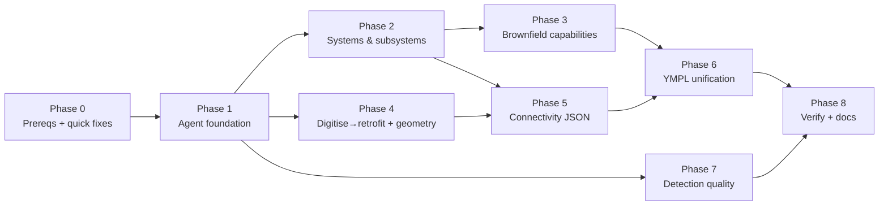

# Brownfield Workflow — Implementation Plan

**Scope:** `standard-main-S` only. Detection stays pure vision-LLM, with no trained-model fallback.
**Status of every "current state" claim below:** verified against the code on 2026-09-15, most of it by
running the real agent loop and the real YMPL export on a copy of digitised project `3-4`.

---

## 0. Implementation status (2026-09-16)

Phases 0–8 are implemented with decisions D1–D6 as recommended. Verified by:

- the backend suite (784 passed, 3 skipped);
- `cargo check` on `frontend/src-tauri`, clean with no warnings, and `cargo test --lib` (55 passed). Both ran
  on a GNU Rust toolchain in a throwaway folder, because the machine has no MSVC build tools. On that
  toolchain the test binary only loads with a common-controls v6 manifest, which a real Tauri build
  embeds, so a scratch copy was patched for the run;
- a frontend type check and production build;
- runs of the exporters on a copy of project `3-4` before and after a retrofit. The copy validated
  against the schema, and its new loop appeared with its full signal chain.

Closed in the second pass (previously open or done differently):

| Item | Now |
|---|---|
| 0.2 Rust compile and tests | `cargo check` clean, `cargo test --lib` 55/55. Removed one dead helper (`ensure_exports_dir`) left behind when YMPL moved to the Python writer. The tests caught a real bug: `delete_project` did not clear the eight tables added for this work (`hierarchy`, `node_hierarchy`, `geometry_*`, `grid_positions`, `describe_pending`, `describe_session_states`), so deleting a retrofitted project would have failed on a foreign key. Fixed in `CHILD_TABLES`. |
| 1.6 `origin` column | `nodes.origin` / `edges.origin` in both schemas. Insert triggers fill it from the extra_json marker for every writer, and a backfill covers older rows (`ORIGIN_SQL`, pinned identical by `test_schema_parity.py`). This fixed a bug: `digitisation_status` counted desktop-drawn nodes (compact JSON) as extracted. |
| 2.2 Tool names | `create_system` and `get_subsystem` added. `create_subsystem` now attaches to an existing system of that name instead of creating a rootless duplicate. |
| 2.4 Subsystem clarification | `agents/describe/services/subsystem_gate.py` runs after the Holistic gate. It asks which subsystem when a named one is ambiguous, or when a request adds equipment, the project has subsystems, and no tag in the message already sits in one. The question and candidates persist in `describe_pending` (`kind: "subsystem"`). Replies can be a number, a name, a system name, or "none". Rounds are bounded, and a different request drops the question. |
| 5.2 / 5.3 Missing sections and direction rules | A new flow-annotation pass (`services/llm_flow_annotation_service.py`, vision LLM, tiled, `STUDIO_FLOW_ANNOTATIONS`) reads arrowheads and electric heat tracing into `geometry_lines`. The exporter now fills `electric_heat_trace` (keyed by the nearest item), `loop_groups` (a shared final element or a signal link) and `spatial_clusters` (symbol boxes within 1.5% of the page's longer side). Direction resolves as `arrow-preassign` → `BFS(root)` → `propagation(node)` → `geometric-fallback`. `expansion_joints` was already filled from `expansion_joint` nodes. |

**Still open:**

| Item | Status |
|---|---|
| 0.1 Credential rotation | **Manual, still required.** See `docs/SECURITY_credential_rotation.md`. |
| 0.5 Engram-Main source | Unavailable. The rule families are rebuilt with this repo's own names. The fixture's numbered rules (`Rule19b`, `Rule21`, `Rule23`) cannot be reproduced without the source. |
| 8.1 `tauri build` and a manual desktop smoke test | Not run. Bundling needs installer tooling that is not on this machine, and the smoke test needs a person at the desktop app. |
| 7.4 Benchmark data | Harness, scorer and runner are in `backend/benchmarks/`, with offline tests. There is **one** ground-truth drawing (`fixtures/ground_truth/pid18.json`), derived from `connectivity_graph 18.json` and **not yet verified by hand**. Labelling nine more drawings needs an engineer. |
| 8.3 Benchmark results | None. A live run calls the vision model and costs money, so it waits for an explicit go-ahead (`--confirm-cost`). |
| Heat tracing vs signal lines | The line tracer may also report a heat-trace run as a dashed signal line. The annotation pass does not remove such duplicates yet. |
| 8.2 `REQUIREMENTS.md` | Does not exist in this repo; nothing to mark. |
| Performance note on 7.3 | Prompt caching is on for system prompts. The symbol tile prompt (~1.5k tokens) is below Haiku 4.5's 4,096-token cache minimum, so it caches only on Sonnet-class models. Line and text tile prompts embed per-tile data and are not cacheable. |

---

## 1. Target workflow

The product this plan delivers, end to end:

1. **Digitise.** An engineer uploads an existing P&ID. It is converted into a digital graph that keeps
   symbols, tags, pipe runs, junctions and their positions on the sheet.
2. **Retrofit.** Through the brownfield agent, the engineer adds new instruments and their accessories
   (root valve, siphon, manifold, transmitter, controller, positioner, actuator, control valve) into a
   named **system and subsystem** of the existing plant, wired with the correct four-way topology.
3. **Export.** A **connectivity graph JSON** and **YMPL** are generated from the same graph, and both
   reflect the retrofit.

Greenfield shares the agent foundation, so every Phase 1 fix benefits it too.

---

## 2. Current state — what is missing or broken

| # | Area | Finding | Evidence |
|---|---|---|---|
| G1 | Placement | Agent-added nodes land far outside the drawing. Stored positions are normalised 0–1; `add_nodes` places at 100–770. | E2E run: new nodes at x 140–770, drawing spans 0.10–0.87 |
| G2 | Prompt | Prompt documents `get_node(node_id)`, `get_connections(node_id)`, `get_loops(loop_number)`; code expects `tag` / `status_filter`. | E2E run: 3 of 8 steps failed; turn ended on step limit |
| G3 | Step budget | `MAX_STEPS = 8`, one tool per turn. A single loop retrofit barely fits; anything larger stops halfway. | `agents/describe/base.py` |
| G4 | Fabricated data | `_build_default_asset_specs` stamps invented manufacturer, model, range and cabinet slot on every added node; they flow into YMPL. | E2E run: `PT-2041` → "Emerson Rosemount 3051S, 0–16 bar" |
| G5 | Duplicates | `add_edges` never checks for an existing identical edge. | Code + E2E run |
| G6 | Data loss | Agent rows have `source_id NULL`. A re-extraction without `--source-id` deletes all of them. | E2E: 0 of 9 kept (Flask path), 9 of 9 kept (desktop path) |
| G7 | Toolset | Brownfield has no update, delete or re-route tools; its registry is identical to greenfield. | `brownfield_agent.py` |
| G8 | Hierarchy | No system/subsystem concept anywhere in schema, tools, UI or exports — only free-text `area`. MongoDB assets already carry `site/plant/unit/area/system/subsystem`, unused. | Schema + `adapters/mongodb.py` |
| G9 | Routing | "Add … to the feed subsystem" routes to `solution`; "add … to the reactor system" routes to `authoring`. Only retrofit/tie-in/existing-line wording reaches brownfield. | `route_message(use_llm=False)` |
| G10 | Orchestration | No flow chains digitise → retrofit. Brownfield never checks that a digitised graph exists. | `app_workflow.py` |
| G11 | Geometry | Stored projects keep **no geometry**: no bbox, no page size on older projects, no line polylines, no junction/crossover records, `loops` table empty. The geometric graph built during extraction is discarded. | DB inspection of `3-4`, `3-8` |
| G12 | Connectivity JSON | The schema-2.0.0 format (fixture `connectivity_graph 18.json`) is generated nowhere. Code comments cite Engram-Main `connectivity.py` / `detect_crossovers.py`, not present in this repo. | Repo-wide search |
| G13 | YMPL | Works, but two writers disagree: Flask adds the `enable:` block, desktop `build_ympl_yaml` emits topology only. | `export_controller.py`, `export.rs` |
| G14 | Schema drift | DB schema is defined twice (`adapters/db.py`, `src-tauri/.../schema.rs`). Rust lacks `grid_positions`, `describe_pending`, `describe_session_states`. `run_describe.py` never runs `init_db()`, so on a desktop-created hub, clarification and session saves fail with "no such table". | Code inspection |
| G15 | Tests | Brownfield tests cover routing, compilation and prompt wording only. No test runs a brownfield turn or the digitise → retrofit → export chain. | `test_studio_greenfield_brownfield.py` |
| G16 | Performance | Symbol and line tile calls run sequentially (median 57 + 40 per page); no benchmark exists to measure detection quality. | Fixture measurement |

---

## 3. Decisions to confirm before starting

| # | Decision | Recommendation |
|---|---|---|
| D1 | Hierarchy levels | Adopt `site → plant → unit → area → system → subsystem`, matching the MongoDB asset `location` document already in use. |
| D2 | Connectivity schema | Target schema **2.0.0** exactly as in the fixture. Obtain Engram-Main's `connectivity.py` if accessible; otherwise derive a JSON Schema from the fixture and rebuild. Add hierarchy as an additive field (bump to `2.1.0`) rather than altering existing fields. |
| D3 | Specification source | Real data only: MongoDB asset inventory when configured, otherwise leave blank and mark `spec_status: "unspecified"`. Never synthesise. |
| D4 | YMPL canonical writer | Python `to_enablesim_ympl`. Desktop spawns a CLI for it (the Flask route answers 401 to the desktop, which holds no session). Keep "topology only" as an explicit option. |
| D5 | Coordinates | Store normalised 0–1 plus `page_w`/`page_h`. Convert to pixels only at export. |
| D6 | Retrofit construction | The LLM chooses **what** to add (package, anchor, subsystem); deterministic code builds **how** (nodes, accessories, edges, placement). |

---

## 4. Phases

Sizes are rough engineer-day ranges for one developer familiar with the codebase.

### Phase 0 — Prerequisites and quick safety fixes · S (1–2 d)

| Item | Work | Closes |
|---|---|---|
| 0.1 | Rotate the credentials listed in `docs/SECURITY_credential_rotation.md` (manual, outside code). | — |
| 0.2 | Install the Rust toolchain; run `cargo check` on `src-tauri` (earlier Rust changes are still uncompiled). | — |
| 0.3 | Call `adapters.db.init_db()` at the start of `run_describe.py` and `run_agentic.py`. | G14 (runtime) |
| 0.4 | Add `grid_positions`, `describe_pending`, `describe_session_states` to `schema.rs`. Add a test that parses both schema files and fails if their table sets differ. | G14 (drift) |
| 0.5 | Request Engram-Main `connectivity.py` and `detect_crossovers.py` access (unblocks Phase 5 design). | G12 |

### Phase 1 — Agent foundation (shared by greenfield and brownfield) · M (4–6 d)

| Item | Work | Closes |
|---|---|---|
| 1.1 | New `services/placement.py`: port `frontend/src/domain/layout/placement.ts` (`pickFreeSpot`, `placeNewNodes`, `clamp01`, `NEW_NODE_OFFSET`). `add_nodes` and `add_junction` place near the anchor in 0–1 space, avoiding occupied spots; direction hints from the message. | G1 |
| 1.2 | Generate each prompt's TOOLS section from the tool registry using `inspect.signature`, injected via `fill_prompt`. Remove hand-written signatures from all describe prompts. Test: every documented argument exists on the function. | G2 |
| 1.3 | Per-agent step budget (`build_tool_agent(max_steps=…)`): brownfield/greenfield 20, others 8. Step-limit reply lists the ops actually applied. | G3 |
| 1.4 | Delete the `_build_default_asset_specs` injection. New `services/asset_specs.py` looks up `fetch_asset_by_tag` when Mongo is configured; otherwise stores `spec_status: "unspecified"`. | G4 |
| 1.5 | `add_edges` / `insert_between`: skip an edge whose `(from, to, kind)` already exists; report skipped edges to the model. | G5 |
| 1.6 | Add `origin` (`extracted` / `authored`) to node and edge `extra_json` (and a column in both schemas). `_rows_from_other_sources` always carries `authored` rows, whatever `source_id` is. | G6 |
| 1.7 | Move the scratchpad E2E harness into `tests/test_brownfield_e2e.py`: scripted LLM, real agent graph, real DB copy, real YMPL export. | G15 (start) |

**Acceptance:** an 8-node pressure loop added near `PI-1110` lands inside the drawing bounds, carries no
invented specs, re-running the same request adds zero duplicate edges, and a Flask-path re-extraction keeps
every authored row.

### Phase 2 — Systems and subsystems · L (6–9 d)

| Item | Work | Closes |
|---|---|---|
| 2.1 | Schema (both files): `hierarchy(id, pid, parent_id, level, name, code, extra_json)` with `level ∈ {site, plant, unit, area, system, subsystem}`; `node_hierarchy(pid, node_id, hierarchy_id)`. Additive migration only. | G8 |
| 2.2 | `repository.py` tools: `list_hierarchy`, `get_subsystem(name_or_id)`, `create_system`, `create_subsystem`, `assign_nodes(tags, subsystem)`, `get_subsystem_contents`. | G8 |
| 2.3 | Seeding: `sync_hierarchy_from_mongo(pid, plant, unit)`; and `bootstrap_hierarchy_from_areas(pid)`, which creates `area` levels from digitised `area` values so existing projects are immediately usable. | G8 |
| 2.4 | `add_nodes` accepts `subsystem`; the Holistic gate resolves an ambiguous or missing subsystem with a clarifying question (reuses `describe_pending`). | G8 |
| 2.5 | Router: add `system`/`subsystem`/`instrument package`/`accessories` wording to brownfield, and make routing state-aware — digitised graph present ⇒ brownfield, empty project ⇒ greenfield. Update `describe_router.md` to match. | G9 |
| 2.6 | Desktop: Rust `get_hierarchy` / `assign_node_hierarchy` commands; Sidebar hierarchy tree; Canvas filter/colour by system; node edit panel shows system and subsystem. | G8 |
| 2.7 | Tests: hierarchy CRUD, Mongo sync with a stubbed client, subsystem clarification round, routing table for the phrasings in G9. | G15 |

### Phase 3 — Brownfield agent capabilities · M (5–7 d)

| Item | Work | Closes |
|---|---|---|
| 3.1 | Extend the brownfield registry: `update_node`, `update_edge`, `delete_nodes`, `delete_edges` (keep the existing confirmation interrupt), plus the Phase 2 hierarchy tools. | G7 |
| 3.2 | New `reroute_edge(from_tag, old_to, new_to)` and `break_line(from_tag, to_tag, at_fraction)` for tie-ins that split an existing run. | G7 |
| 3.3 | **Instrument package tool** `add_instrument_package(anchor_tag, package, subsystem, tag_series)`, backed by a template catalogue in `services/instrument_packages.py`: `pressure`, `temperature` (thermowell + RTD), `flow`, `level`, `control_valve`. Code creates every accessory, the four-way edges, placement and subsystem assignment in one transaction. | G3, G5, G7 |
| 3.4 | `next_tag(prefix, series)` helper that follows the plant's numbering and never reuses a tag. | G7 |
| 3.5 | Post-write validation: run `check_loop_completeness` and `validate_drawing` scoped to the touched subsystem; include the result in the reply. | — |
| 3.6 | Rewrite `describe_brownfield.md` around packages and hierarchy; Phase 3 of its reasoning checklist calls the package tool instead of enumerating accessories by hand. | G2, G3 |
| 3.7 | Tests: one scripted E2E per package, duplicate-safety on repeat, tie-in via `break_line`, delete confirmation, tag-series numbering. | G15 |

### Phase 4 — Digitise → retrofit flow and geometry persistence · L (7–10 d)

| Item | Work | Closes |
|---|---|---|
| 4.1 | Persist geometry at extraction, in both the classic and agentic pipelines: symbol `bbox` + `page_w/page_h` per node; new `geometry_lines(pid, source_id, page, line_id, type, style, points_json, direction)`; new `geometry_junctions(pid, source_id, page, junction_id, kind, point_json)` with kinds `t_junction`, `endpoint_share`, `crossover`, `open_endpoint`. Source: `build_geometric_connectivity` output (classic) and `candidate_graph` (agentic `relationship_agent`). | G11 |
| 4.2 | Link edges to geometry: `line_id` on edges when a run backs the connection; authored edges carry `origin: authored` and no line. | G11 |
| 4.3 | `re-extract` carries geometry for other documents exactly as nodes are carried (extend `_rows_from_other_sources`). | G6, G11 |
| 4.4 | Orchestration: `run_app_request` accepts `{source_path, message, mode: "brownfield"}`; extracts if the project is not digitised or the file hash changed, then runs the brownfield turn on the result. | G10 |
| 4.5 | Brownfield gate: refuse with a clear message when the project has no digitised graph. | G10 |
| 4.6 | Desktop: after a successful extraction, Ingest shows **Start retrofit**, which opens Describe in agent mode with brownfield context. Canvas reloads the graph after an agent turn that applied writes. | G10 |
| 4.7 | Tests: geometry round-trip through re-extraction, multi-document isolation, orchestration with a stubbed extractor. Run the 20-scenario regression suite and the multipage E2E unchanged. | G15 |

### Phase 5 — Connectivity graph JSON exporter · L (8–12 d)

Depends on Phase 2 (hierarchy) and Phase 4.1 (geometry).

| Item | Work | Closes |
|---|---|---|
| 5.1 | `schemas/connectivity_graph_2_0_0.schema.json`, from Engram-Main if obtained, otherwise derived from the fixture. Test: the fixture validates. | G12 |
| 5.2 | `adapters/connectivity_export.py` building every section from DB graph + persisted geometry: | G12 |
|  | • `nodes` — `type` mapped from `kind` (`equipment`, `valve`, `safety_valve`, `regulator`, `mechanical`, `instrument`, `inline_component`, `boundary`) plus junction kinds; `point` and `bbox` in pixels via `page_w/page_h`; authored nodes get a nominal bbox and `_source: describe_agent`. | |
|  | • `edges` — `id`, `from`, `to`, `line_id`, `direction`, `is_expansion_joint`, `_logical`, `_source`, `_jx_roles`. | |
|  | • `lines` — keyed by `line_id`: `type` (process/signal), `style` (solid/dashed), `points`, `direction`. | |
|  | • `control_loops` — from `domain/loop_inference.infer_loops`: `loop_id`, `loop_type`, `instruments`, `connected_components`, `connected_inline`, `process_line_junctions`. | |
|  | • `signal_paths` — chains over signal/pneumatic edges: `signal_id`, `chain`, `chain_ids`, `start_node`, `end_node`, `path`, `signal_role`. | |
|  | • `electric_heat_trace`, `expansion_joints`, `spatial_clusters`, `loop_groups` — populated when geometry supports them, otherwise empty arrays (never omitted). | |
|  | • `metadata` — `schema_version`, `diagram_type`, `generated_at`, all counts. | |
| 5.3 | Flow-direction propagation (`_logical`, `direction`): BFS from boundaries/sources through junctions, following the rule families visible in the fixture (`arrow-preassign`, `BFS(…)`, `propagation(…)`, `Rule23`). Port from Engram-Main if available. | G12 |
| 5.4 | Additive hierarchy per node (`system`, `subsystem`) under schema `2.1.0`; `2.0.0` output stays byte-compatible when the option is off. | G8, G12 |
| 5.5 | Surfaces: Flask `GET /api/projects/<pid>/export/connectivity`; `export_connectivity_cli.py` spawned by a new Rust `export_connectivity` command; ExportScreen button; MCP server tool. | G12 |
| 5.6 | Graceful degradation for projects digitised before 4.1: export topology, mark `metadata.geometry: "unavailable"`, prompt re-extraction. | G11 |
| 5.7 | Regenerate automatically after a brownfield turn that applied writes (setting, default on), saved under `projects/<pid>/exports/`. | — |
| 5.8 | Tests: schema validation, golden export for a synthetic project, retrofit loop appears in `control_loops` and `signal_paths`, pixel/normalised round-trip. | G15 |

### Phase 6 — YMPL unification · S (2–3 d)

| Item | Work | Closes |
|---|---|---|
| 6.1 | New `export_ympl_cli.py` wrapping `to_enablesim_ympl`; Rust `export_ympl` spawns it instead of `build_ympl_yaml`. Option `--topology-only` preserves the current desktop output. | G13 |
| 6.2 | YMPL carries hierarchy and real specifications only. | G4, G8 |
| 6.3 | Tests: Flask and desktop outputs identical for the same project; round-trip through `sdk/ympl_parser`; retrofit loop present. | G13, G15 |
| 6.4 | Regenerate alongside the connectivity JSON after brownfield writes (shares the 5.7 setting). | — |

### Phase 7 — Detection quality and performance (pure LLM) · M (5–8 d)

Can start after Phase 1, in parallel with Phases 2–6.

| Item | Work | Closes |
|---|---|---|
| 7.1 | Bounded parallel tile calls in the symbol and line services, rate-limit aware and configurable. | G16 |
| 7.2 | Zoom-in localisation pass: re-query a tight crop per detection to sharpen its box. | G16 |
| 7.3 | Prompt caching for the fixed per-tile prompt where the provider supports it. | G16 |
| 7.4 | Benchmark harness on ~10 hand-labelled fixture drawings: symbol precision/recall, tag accuracy, connection F1, seconds and tokens per page. Results committed per run. | G16 |

### Phase 8 — Verification and documentation · S (2–3 d)

| Item | Work |
|---|---|
| 8.1 | `cargo check`, `tauri build`, and a manual desktop smoke test of the full acceptance scenario (§6). |
| 8.2 | Update `backend/CLAUDE.md`, `agents/README.md`, and the Describe help text; mark superseded items in `REQUIREMENTS.md`. |
| 8.3 | Record benchmark results from 7.4 next to the release. |

---

## 5. Sequencing

| Phase | Size | Rough effort |
|---|---|---|
| 0 | S | 1–2 d |
| 1 | M | 4–6 d |
| 2 | L | 6–9 d |
| 3 | M | 5–7 d |
| 4 | L | 7–10 d |
| 5 | L | 8–12 d |
| 6 | S | 2–3 d |
| 7 | M | 5–8 d |
| 8 | S | 2–3 d |
| **Total** | | **40–60 d**, about 5–8 weeks with Phase 7 in parallel |

Phase 5 is the largest uncertainty: with Engram-Main's source it sits near the low end; rebuilding the
direction-propagation rules from the fixture alone pushes it to the high end.

---

## 6. Definition of done — acceptance scenario

Run on fixture drawing `pid18` in the desktop app:

1. Upload and digitise. The graph has geometry: bboxes, line runs, junctions.
2. Describe, agent mode: *"Add a pressure control loop to the Feed Supply Header subsystem, tied in at the
   existing header."*
3. The brownfield agent handles it, asks which subsystem if ambiguous, and builds the full accessory package.
4. Every new node sits inside the drawing, is assigned to the subsystem, carries no invented
   specification, and repeating the request adds nothing.
5. The connectivity JSON validates against the schema, and the new loop appears in `nodes`, `edges`,
   `control_loops` and `signal_paths`.
6. YMPL from Flask and from the desktop is identical, parses with `sdk/ympl_parser`, and contains the loop.
7. Re-extracting the drawing, by either path, keeps the retrofit.
8. The full test suite passes, and `cargo check` is clean.

---

## 7. Risks

| Risk | Mitigation |
|---|---|
| Geometry persistence (4.1) changes extraction output and could regress it. | Additive tables only; run the 20-scenario regression suite and multipage E2E before merge. |
| Schema defined in two languages keeps drifting. | 0.4 parity test fails the build on any difference. |
| Engram-Main unavailable; direction rules are intricate. | Build 5.2 sections that need no direction first; ship `direction` as a follow-up behind a flag. |
| LLM variance in retrofits. | D6: packages are deterministic templates; the model only chooses package, anchor and subsystem. |
| Projects digitised before Phase 4 lack geometry. | 5.6 degrades explicitly and prompts re-extraction. |
| Real specifications depend on Mongo being configured. | D3: blank-and-flagged is an acceptable outcome; never fabricate. |
| Credentials still live. | 0.1 is a prerequisite, not a code task. |
